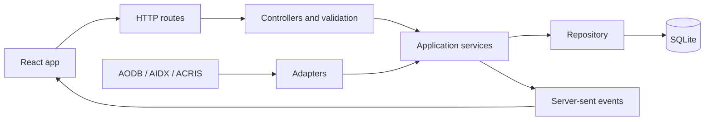

# Architecture

Meridian has a React client, a Node API and a local SQLite database. The API owns simulation time, decisions and persisted state; browsers display that shared state rather than simulating it themselves.

## Where things live

- `apps/api/src/app.mjs` wires dependencies and HTTP middleware. `server.mjs` checks runtime configuration, starts the listener and handles shutdown.
- Routes and controllers translate HTTP requests into service calls. Services implement application behavior; repositories handle database access.
- Feed-specific parsing and mapping live in `adapters/`. Shared feed contracts are in `packages/shared-types/`.
- The React app groups pages and components under `apps/web/src/features/`. Shared state, navigation and layout live under `app/`.
- SQLite migrations are in `migrations/`; deterministic demo data is created by the database seed code.

## What happens when a flight is delayed

1. The API validates the delay command and passes it to the simulation service.
2. A coordinated write updates the flight, its gate assignment and the event record.
3. The service recalculates affected audiences and requests new screen decisions.
4. The decision service filters and scores campaigns. `models/decision.model.mjs` checks the proposed result against trusted evidence. If the evidence is invalid, the system uses approved airport information instead.
5. The API publishes an event. Connected clients refresh their view from the shared state.
6. QR scans, claims and redemptions are stored as separate events; redemptions affect reporting and later decisions.

## State and process limits

SQLite stores canonical records, while raw feed values remain available for traceability. Writes use transactions; nested writes use savepoints. Playlist records point to decisions so evidence is stored once.

The clock is shared across the application. One process holds a renewable database lease to advance it. Other processes on the same host can use the same local SQLite file and synchronize through database version checks. This is not a multi-host setup, and SQLite files should not be placed on network filesystems. The default Compose setup runs one process.

Simulation can run at 1×, 10× or 60× speed. The clock evaluates in 15-second simulated intervals. Reset and time jumps affect every connected user. Old decisions are retained only up to a fixed limit.

## Demo estimates and integrations

Flights, passenger profiles, queue readings and revenue are synthetic. Forecasts and yield figures are planning estimates, not operational data or guaranteed revenue. Profiles are aggregate; the app does not identify individual passengers or infer religion.

The built-in feed and creative providers work offline. Optional HTTP providers use bounded requests, timeouts and validation; see the [adapter guide](ADAPTER_GUIDE.md). Local schema validation does not amount to vendor certification or proof of compatibility with every airport.
