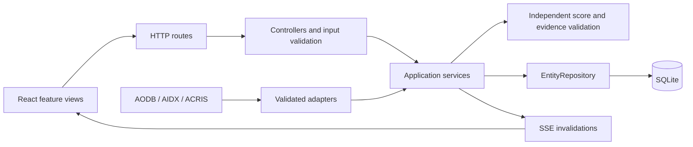

# Architecture

## Boundaries

`app.mjs` is the composition root. It constructs dependencies, installs middleware and registers controllers. `server.mjs` validates deployment settings, opens the listener and owns shutdown. Controllers handle HTTP input/output; services own domain rules; the repository owns persistence. Features do not open their own database or advance a browser-local clock.

`AirportEngine` is a small application facade. Presence, campaign decisions, simulation transitions, promotions, forecasting and snapshots each have a named service. `models/decision.model.mjs` reproduces scores and checks trusted evidence independently of candidate selection.

## Follow a delay

1. `simulation.routes.mjs` dispatches a validated command to its controller.
2. The runtime coordinator opens a `BEGIN IMMEDIATE` transaction and refreshes stale state.
3. The simulation service updates the canonical flight and gate assignment, records idempotency/provenance, recalculates affected audiences and evaluates their screens.
4. The decision service applies hard rules, scores candidates and independently verifies the proposed winner. It writes a complete decision and a playlist reference. Failed evidence produces a safe fallback.
5. A sequenced SSE notification makes connected clients refresh shared state. Browser displays render the actual backend playlist.
6. QR scans, claims and redemptions use separate records. Redemption updates reporting and subsequent decisions.

## Persistence and concurrency

SQLite stores canonical entities as JSON with a composite `(kind,id)` key. Raw feed fields remain available for provenance. Schema migrations are under `migrations/`; seeding is separate and deterministic. Activity has an indexed campaign key. Playlist rows refer to decisions rather than duplicating their full evidence.

Write transactions serialize commands and nested writes use savepoints. A database-backed renewable lease elects one clock owner. Other processes poll SQLite `data_version`, invalidate their identity map, reload shared state and notify their own SSE clients. Two-process tests cover duplicate feed events and competing anonymous claims. Lease expiry permits takeover after a process disappears.

This supports multiple Node processes sharing **one local SQLite file on one host**. It does not provide a distributed multi-host database, cross-host filesystem safety or an external event bus. The default Compose deployment uses one process. HTTP rate limits are per process and are not an authentication boundary.

A one-second timer advances the shared clock at 1×/10×/60×, evaluating every fifteen-second simulated slot. Pausing stops simulated time. Reset/jump is global. Decision retention is bounded to the latest 900 complete decisions; activity is aggregated by day/screen/campaign where appropriate.

## Forecasts and integrations

Forward schedules vary deterministically by date and flight, with bounded time/demand changes. The heatmap reads all 900 canonical movements rather than the compact dashboard preview. Yield separates committed bookings from estimated saleable inventory multiplied by an editable fill-rate assumption. These are synthetic planning estimates, not operational forecasts or guaranteed revenue.

Festival eligibility uses configured calendar entries with zone and time boundaries. Boarding and recent gate changes can also activate campaign rules. Calendar evidence is checked against trusted stored input. No personal identity or inferred religion is used.

Offline adapters/providers are the default. Optional HTTP providers have explicit protocols, bounded requests, timeouts and response validation. Official AIDX XSD validation is local; published ACRIS queue-model validation is local. Schema compatibility is not third-party certification.

## Frontend organization

`app/App.tsx` owns persona selection, shared state, dialogs and navigation. `app/layout/` holds the sidebar, header and simulation bar. Each `features/<domain>/` contains its own pages and components. Shared components handle recurring UI patterns. The common brand tokens preserve the landing/workspace identity; Admin defaults to a dark appearance and can be switched to light in Settings.

Translation is an explicit `translateText()` presentation call with a Hindi catalogue. React uses its standard JSX runtime. Feed IDs, enum values and user-authored content are not silently translated. Flexible master-data JSON records are runtime-validated at the API boundary; stable feed contracts live in `packages/shared-types`.
